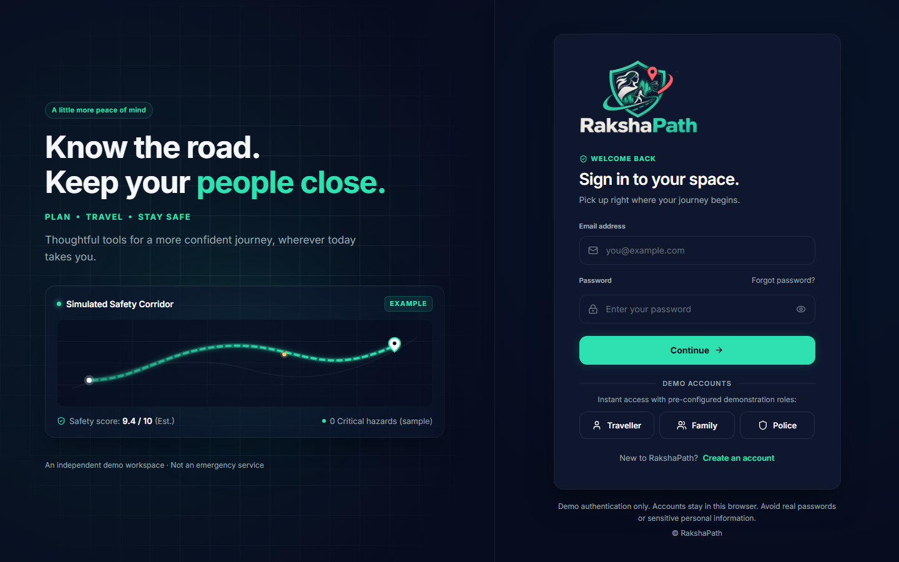
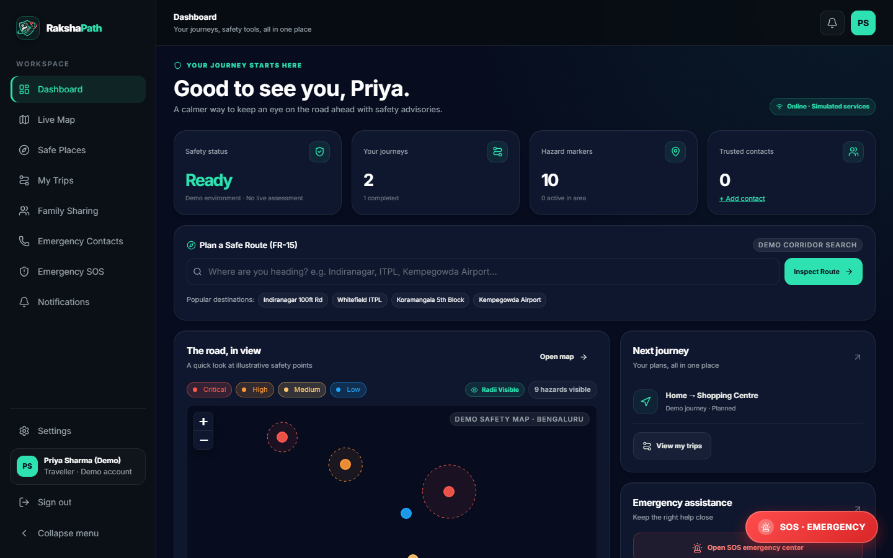
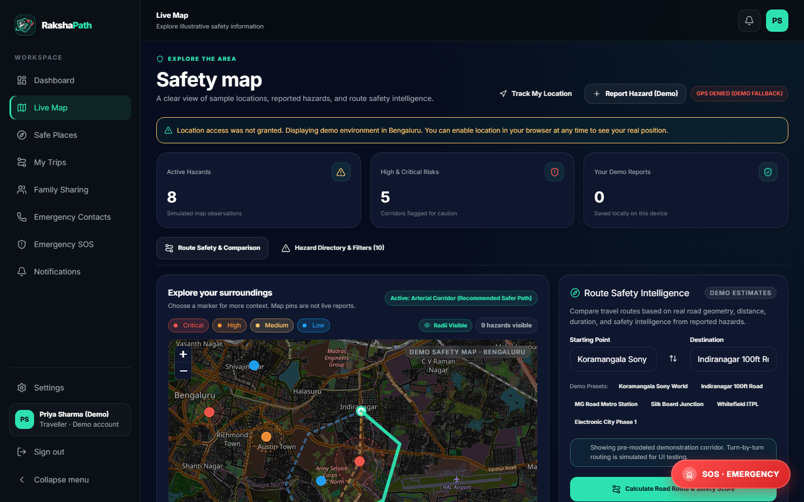
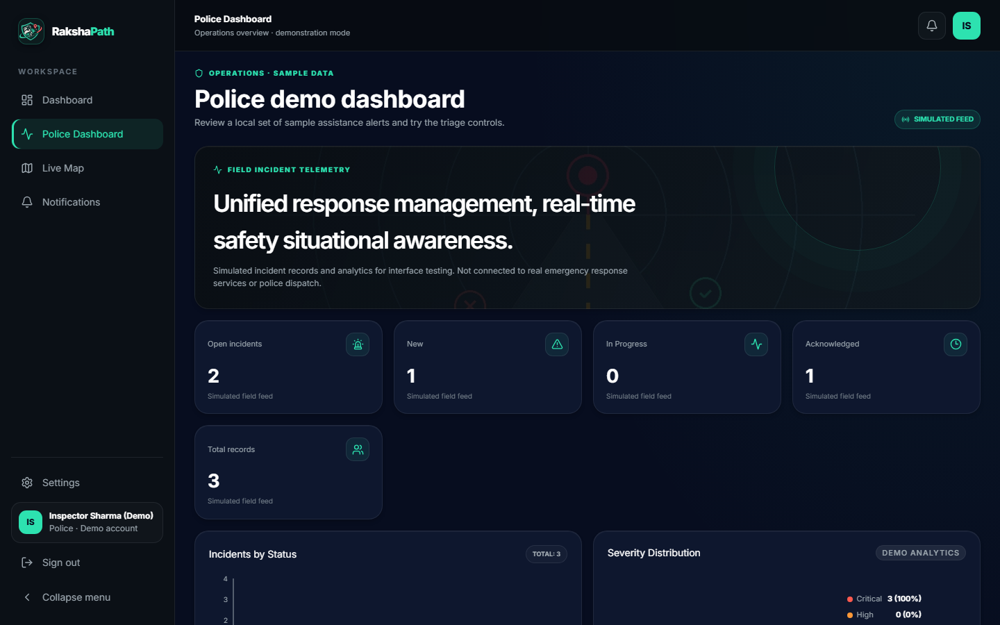

# RakshaPath 🛡️🚗

> **Plan • Travel • Stay Safe**  
> A proactive safe-travel platform: collects road, weather, and disaster hazards automatically, scores route safety, warns drivers before they hit danger, and provides rapid online/offline SOS to family and police.

---

## 1. Overview & Key Capabilities

* **Automated Hazard Ingestion**: Ingests traffic incidents, weather risks, and official disaster alerts (TomTom, Open-Meteo, NDMA, IMD) without manual reports.
* **Proactive Trip Warnings**: Monitors active routes; sends FCM push warnings before the user approaches a danger zone.
* **Safety Scoring (1-10)**: Evaluates road segments by hazard severity, weather, night conditions, and emergency service proximity.
* **Dual-Channel Emergency SOS**:
  * **Online**: Instant backend broadcast to family (SMS/push) and the live police web dashboard (< 10s).
  * **Offline**: Direct device-level SMS containing last-known GPS map link and local safety actions (siren/flashlight).

---

## Screenshots

### 1. Authentication & Demonstration Access (1440px)


### 2. Traveller Safety Dashboard


### 3. Interactive Live Safety Map & Legend Dock


### 4. Police Operations & Incident Center


---

## 2. Features by Scope Level

| Level | Name | Features | Status |
| :--- | :--- | :--- | :--- |
| **Level 0** | Scaffold & Infra | Monorepo structure, Docker Compose (PostGIS + Redis + FastAPI), CI workflow, config | **Done** |
| **Level 1** | Core | Auto hazards ingestion, route rendering, map pins, trip tracking, push alerts, online SOS, police web dashboard, contacts | **Partially Done (Backend Step 2 Done; Frontend Web Demo Done; Live Integration Deferred)** |
| **Level 2** | Reliable | Offline SMS SOS, avoid-area alternate routing, route safety score v1, missed-update alert, alert deduplication, retry queue | **Not Done Yet** |
| **Level 3** | Intelligent & Cloud | Hazard history warehouse, hotspot analytics, ML segment risk model, news-to-hazard LLM parser, cloud CI/CD | **Not Done Yet** |
| **Level 4** | Stretch | Shake & volume hardware SOS triggers, check-in timer, fake call, optimal departure timing | **Not Done Yet** |

---

## 3. Frontend Quickstart (React + Vite Web Application)

The active client implementation is the unified **RakshaPath Web Application** located in `frontend/web`. It integrates the **Traveller Application**, **Family Dashboard**, and **Police Operations Dashboard** within a single responsive Single Page Application.

### 1. Unified Web Application (`frontend/web`)
```bash
cd frontend/web

# Install dependencies
npm install

# Start local development server
npm run dev
# Open http://localhost:5173 in browser

# Run automated test suite (Vitest — 10 test suites, 171 tests)
npm test

# Run linter (oxlint) and static production build
npm run lint
npm run build
```

### 2. Pre-Configured Demonstration Accounts (FR-100)
The web application provides one-click instant demonstration authentication buttons directly on the Sign In interface (`/login`). Use the one-click demo buttons on `/login` to sign in instantly with pre-configured demonstration roles:

* **Traveller**: `traveller.demo@rakshapath.local` (routes to `/dashboard` — safe routing, hazard monitoring, and emergency SOS tools)
* **Family**: `family.demo@rakshapath.local` (routes to `/family` — private trip sharing and family safety check-in view)
* **Police**: `police.demo@rakshapath.local` (routes to `/police` — incident triage, active SOS feed, and safety operations)

> **Note (Demo Only)**: Demonstration accounts and sessions are managed client-side in browser storage. They do not connect to a production identity provider or backend auth service. Password credentials are kept solely in client demonstration constants (`src/constants/demoUsers.js`) and are never used in production.

### 3. Mobile Safe Navigation App (Flutter Android — Architecture Preserved)
*Per PRD v5.0+, active development is focused on the React + Vite web platform (`frontend/web`). The mobile Flutter implementation is preserved in `/frontend/mobile` for future native packaging.*
```bash
cd frontend/mobile
flutter analyze
flutter test
```

---

## 4. Tech Stack

| Component | Technology | Role |
| :--- | :--- | :--- |
| **Primary Web Application** | React (Vite / SPA), Plain CSS (Custom Design System), Leaflet, Lucide Icons | Unified client for Traveller, Family & Police interfaces |
| **Mobile App (Preserved)** | Flutter (Android target), Riverpod, `flutter_map`, OpenStreetMap | Native mobile implementation |
| **Backend API** | FastAPI (Python 3.11), SQLAlchemy 2.0, GeoAlchemy2, Alembic | Core API & spatial services (integration deferred) |
| **Database & Cache** | PostgreSQL 16 + PostGIS 3.4, Redis 7 | Spatial data storage & session caching |
| **Routing & Geocoding** | OSRM / OpenRouteService, OpenStreetMap | Road route generation & telemetry projection |
| **Hazard Services** | TomTom Traffic, Open-Meteo, NDMA / IMD | Traffic & environmental alert data |
| **Infrastructure** | Docker, Docker Compose, GitHub Actions | Containerized local stack & CI pipelines |

---

## 5. Quickstart (Docker Compose)

### 1. Configure Environment
```bash
cp .env.example .env
```

### 2. Launch Local Stack
```bash
docker compose up -d --build
```

### 3. Apply Migrations & Seed Sample Hazards
```bash
docker compose exec backend alembic upgrade head
docker compose exec backend python -m app.db.seed
```

### 4. Verify Health Check
```bash
curl http://localhost:8000/health
```

---

## 6. Project Monorepo Structure

```text
RakshaPath/
├── .agent/rules/         # Team architectural rules & guidelines
├── .github/workflows/    # Automated CI (lint + pytest)
├── backend/              # FastAPI backend service
│   ├── alembic/          # Database migrations
│   ├── app/              # Application source code (models, core, db)
│   └── tests/            # Test suite (mocked + real PostGIS spatial tests)
├── frontend/
│   ├── web/              # Primary unified React + Vite web application (Traveller, Family, Police)
│   ├── dashboard/        # Legacy standalone police operations dashboard
│   └── mobile/           # Flutter Android safe travel application (architecture preserved)
├── docs/                 # Architecture, API, DB, Setup, Testing, Frontend docs
├── ml/                   # ML road-risk model & news extraction
├── infra/                # Database scripts & cloud deployment assets
├── docker-compose.yml    # PostGIS + Redis + Backend container definitions
├── .env.example          # Environment variable template
├── CONTRIBUTING.md       # Contribution, branching, and PR rules
├── DESIGN.md             # Visual design system & design token specifications
├── PRD.md                # Product Requirements Document (PRD v5.3)
└── README.md             # Project overview & quickstart
```

---

## 7. Current Project Status

| Module | Scope Level | Status | Notes |
| :--- | :--- | :--- | :--- |
| Monorepo & Infra | Level 0 | **Done** | Docker Compose, PostGIS init, Redis, CI pipeline ready |
| Backend `/health` | Level 0 | **Done** | Verifies PostgreSQL, PostGIS, and Redis connectivity |
| Database Schema & Migrations | Level 1 | **Done** | Alembic `0001_initial_schema`, PostGIS GiST indexes, operators table, constraints |
| Hazard Ingestion Connectors | Level 1 | **Done** | TomTom & Open-Meteo ingestion, 50m spatial dedupe, auto-archival |
| Unified Web Application (`frontend/web`) | Level 1 & 2 | **Demo only** | Responsive SPA with Traveller, Family, and Police interfaces; full test suite passing (171 tests); live backend integration deferred |
| Client-Side Demo Auth (FR-100) | Level 1 | **Demo only** | PBKDF2 (600k iterations) client-side hashing, role segregation, seeded demo roles in browser storage; no live identity provider |
| Real Road Routing & Map Intelligence | Level 1 & 2 | **Partial** | OSRM road routing, client-side safety score calculation, hazard radius overlays, collapsed legend; live traffic server integration deferred |
| GPS Telemetry & Journey Tracking | Level 2 | **Demo only** | Browser Geolocation API tracking, orthogonal route projection, 60m off-route detection, auto-arrival, demo movement fallback |
| Emergency SOS & Siren (Demo) | Level 1 & 4 | **Demo only** | 5s countdown, cancelable dispatch, Web Audio siren sound synthesis, simulated police triage feed; no live cellular SMS / 112 gateway |
| Backend Integration & Live APIs | Level 1 | **Deferred** | Integration with FastAPI postponed until frontend sign-off (PRD Rule 4/5) |
