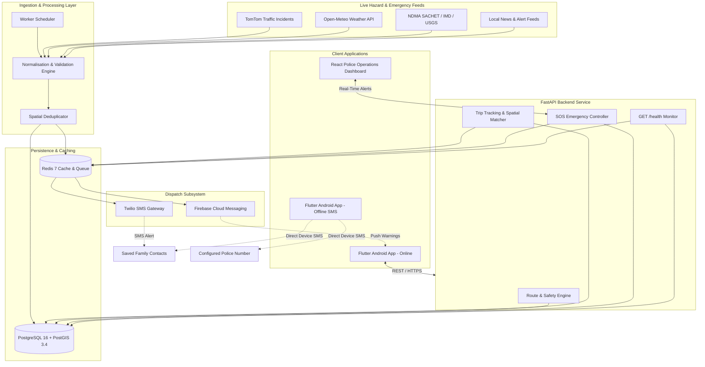

# RakshaPath: Architecture Diagram & Service Responsibilities

## 1. System Architecture Diagram

---

## 2. Service Responsibilities

### **1. Ingestion & Validation Engine**
* **Responsibility**: Regularly pulls unstructured incident data from external APIs, transforms coordinates into WGS84 format, maps incident codes to unified severity levels, and rejects invalid payloads.
* **Failure Handling**: Catches network timeouts, records failures in `hazard_sources_log`, and utilizes cached data or sample fixtures.

### **2. Spatial Route & Safety Engine**
* **Responsibility**: Computes turn-by-turn routes via OSRM/ORS, executes PostGIS spatial queries (`ST_DWithin`) against the hazard dataset, and calculates the route safety score.

### **3. Trip Tracking & Warning Subsystem**
* **Responsibility**: Ingests periodic GPS updates from active trips, maintains the last-seen status, detects proximity to hazards 5 km ahead, and triggers proactive FCM push alerts.

### **4. Emergency SOS Controller**
* **Responsibility**: Receives SOS payloads, writes emergency records to PostgreSQL, updates the police dashboard in real-time, and fires SMS dispatch tasks to Twilio.

### **5. Police Operations Dashboard**
* **Responsibility**: Provides a real-time command-center view for police operators to monitor incoming SOS alerts, inspect live user coordinates, acknowledge emergencies, and record resolution notes.
