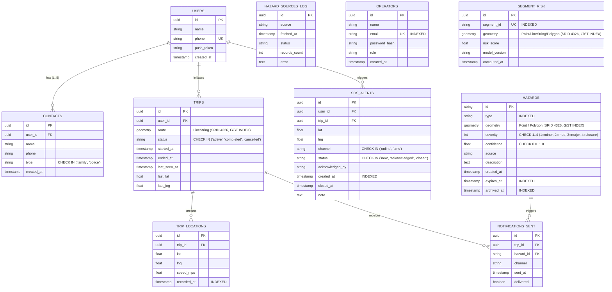

# RakshaPath: Database & Spatial Schema Design

* **Database Engine**: PostgreSQL 16
* **Spatial Extension**: PostGIS 3.4
* **ORM & Migration**: SQLAlchemy 2.0 + GeoAlchemy2 + Alembic (Migration: `0001_initial_schema`)
* **Coordinate System**: WGS 84 (SRID: `4326` storage, cast to `geography` for metric distance queries)

---

## 1. Entity Relationship (ER) Diagram



---

## 2. Spatial Query Specifications

### Route-Hazard Spatial Matching (`ST_DWithin`)
All metric distance calculations are performed on spheroidal `geography` casts to preserve geographic accuracy across latitude gradients:

```sql
SELECT 
    h.id, 
    h.type, 
    h.severity, 
    h.description,
    ST_Distance(h.geometry::geography, ST_GeomFromText(:route_wkt, 4326)::geography) AS distance_meters
FROM hazards h
WHERE h.archived_at IS NULL
  AND ST_DWithin(h.geometry::geography, ST_GeomFromText(:route_wkt, 4326)::geography, :buffer_meters)
ORDER BY distance_meters ASC;
```

---

## 3. Constraints & Indexes Summary

| Table | Index / Constraint | Purpose |
| :--- | :--- | :--- |
| `hazards` | `idx_hazards_geometry` (GiST) | Accelerated spatial intersection & proximity queries |
| `hazards` | `check_hazard_severity_range` | Restricts severity values to `1 <= severity <= 4` |
| `hazards` | `check_hazard_confidence_range` | Restricts confidence values to `0.0 <= confidence <= 1.0` |
| `hazards` | `idx_hazards_type`, `idx_hazards_expires_at` | Rapid filtering during scheduled ingestion & cleanup |
| `trips` | `idx_trips_route` (GiST) | Spatial lookup for active routes |
| `contacts` | `check_contact_type` | Enforces `type IN ('family', 'police')` |
| `operators` | `idx_operators_email` (UNIQUE) | Fast, unique authentication lookups for police dashboard |
